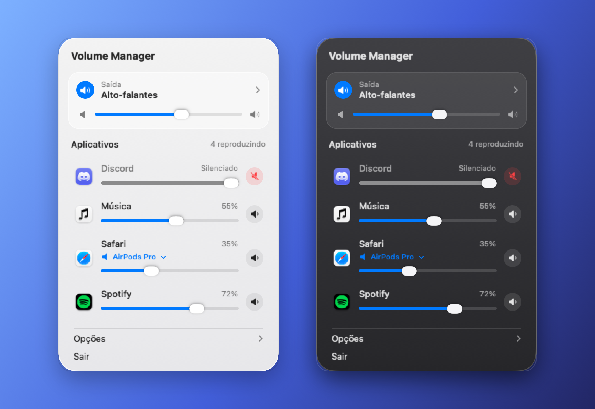
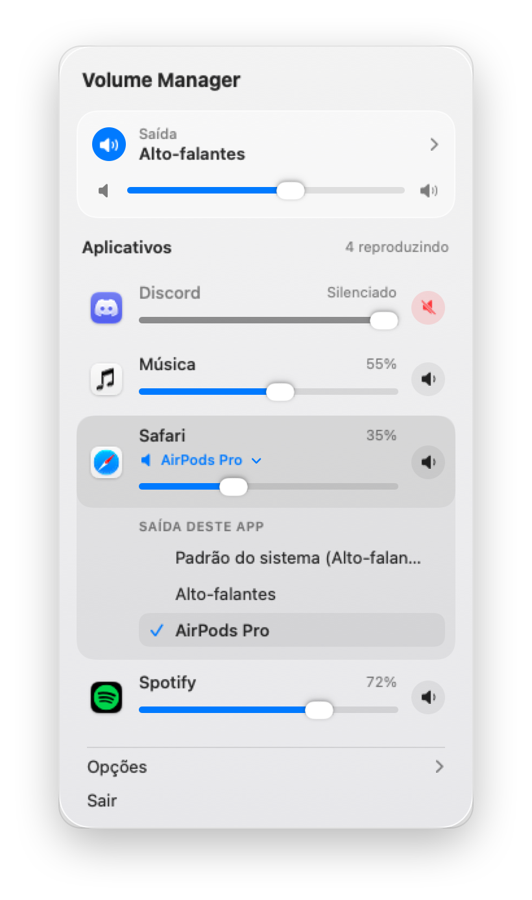
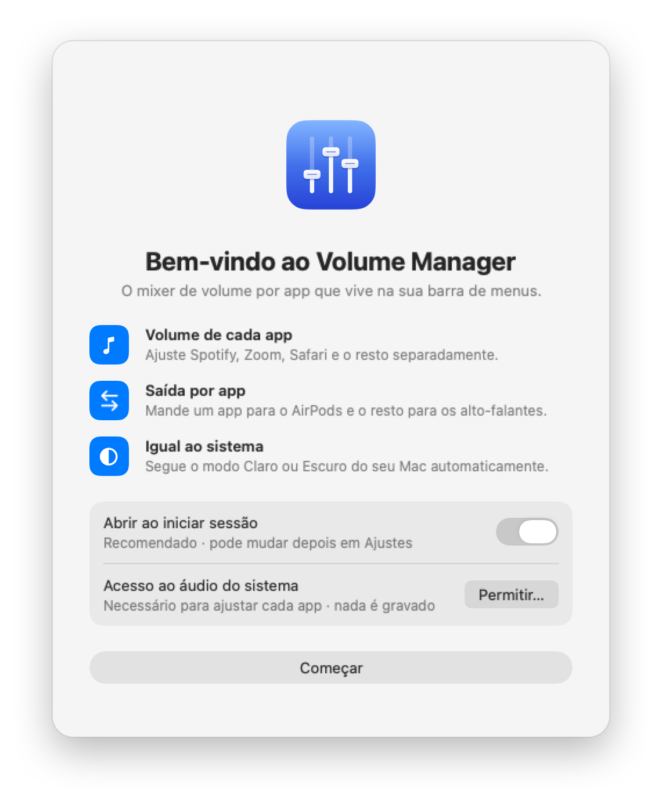
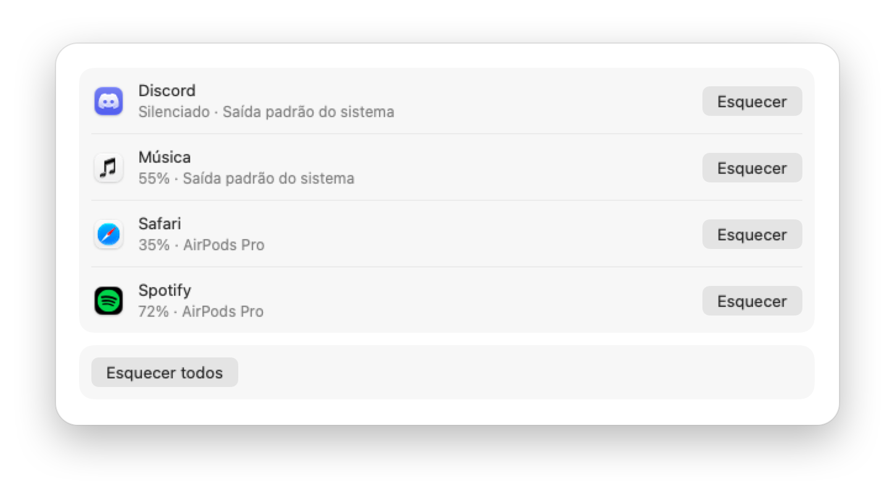
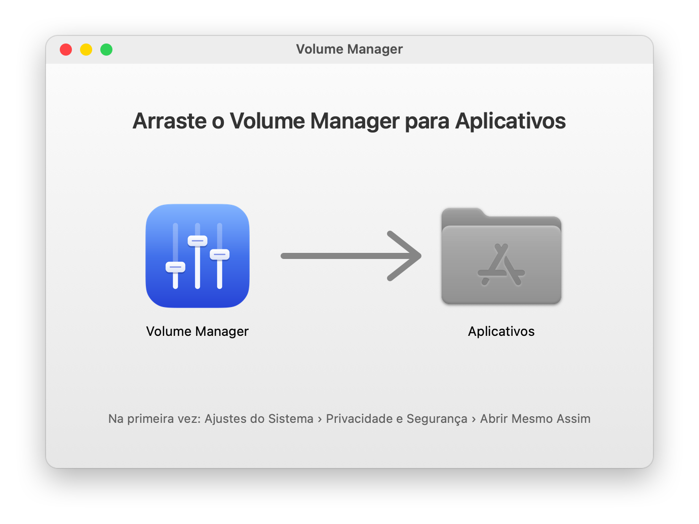

<div align="center">


# Volume Manager

**Mixer de volume por app para o macOS, direto na barra de menus.**

Baixe o volume do navegador sem mexer no do Spotify, silencie só um app ou mande cada app para uma
saída de áudio diferente. Nativo, leve, sem driver e sem extensão de kernel.


[Download](https://github.com/eduardo-toste/volume-manager/releases) ·
[Instalação](#instalação) ·
[Privacidade](#privacidade-e-segurança) ·
[Compilar](#compilar-a-partir-do-código)

<br>



</div>

## Recursos

- **Volume de cada app** — um slider de 0 a 100% e um botão de mudo para cada app que está tocando.
- **Saída por app** — mande o Spotify para os AirPods e deixe o resto nos alto-falantes.
- **Volume e saída geral** — o card “Saída” controla o dispositivo padrão do sistema, como a
  Central de Controle.
- **Lista ao vivo** — mostra só os apps que estão reproduzindo áudio ou em chamada (Discord, Zoom,
  FaceTime); quem para de tocar sai da lista sozinho.
- **Lembra suas escolhas** — volume, mudo e saída de cada app voltam a valer quando ele tocar de novo.
- **Qualidade idêntica à nativa** — o processamento é só `amostra × ganho` em Float32. Em 100% as
  amostras são copiadas bit a bit; sem efeitos, sem conversão de formato, sem reamostragem.
- **Igual ao sistema** — segue o modo Claro/Escuro e a cor de destaque do macOS, com VoiceOver,
  navegação por teclado e respeito a Reduzir transparência e Reduzir movimento.
- **Nunca deixa um app mudo** — se algo falhar, o app devolve o som original. Fechar ou travar o
  Volume Manager também devolve o áudio de todos os apps ao padrão do macOS.

## Conheça

### Uma saída diferente para cada app

Clique no nome de um app para escolher para onde vai o áudio dele. Os outros continuam na saída
padrão do sistema.

<p align="center">
  <picture>
    <source media="(prefers-color-scheme: dark)" srcset="docs/images/popover-routing-dark.png">
    
  </picture>
</p>

### Primeiro uso

Na primeira abertura, uma janela de boas-vindas pede a permissão de áudio do sistema e liga a
abertura automática ao iniciar sessão (você pode desligar depois).

<p align="center">
  <picture>
    <source media="(prefers-color-scheme: dark)" srcset="docs/images/welcome-dark.png">
    
  </picture>
</p>

### Ajustes

Em **Ajustes › Aplicativos** ficam os apps lembrados, com o volume e a saída salvos. Dá para
esquecer um app ou todos de uma vez. Os Ajustes também têm **Geral** (abrir ao iniciar sessão,
lembrar volumes, incremento do volume), **Dispositivos** e **Sobre**.

<p align="center">
  <picture>
    <source media="(prefers-color-scheme: dark)" srcset="docs/images/settings-apps-dark.png">
    
  </picture>
</p>

> As imagens são renderizadas a partir das próprias telas do app (SwiftUI), com os textos reais em
> pt-BR e os ícones dos apps instalados.

## Requisitos

| | |
|---|---|
| Sistema | macOS 15 Sequoia ou mais novo |
| Processador | Apple Silicon (o build publicado é arm64) |
| Permissão | Apenas **áudio do sistema**, pedida no primeiro uso |

## Instalação

<p align="center">
  
</p>

1. Baixe `Volume-Manager-<versão>.dmg` e o `SHA256SUMS` **somente** da página de
   [Releases](https://github.com/eduardo-toste/volume-manager/releases). Não baixe de nenhum outro lugar.
2. [Confira o SHA-256](#conferir-o-sha-256).
3. Abra o DMG e arraste **Volume Manager** para **Aplicativos**.
4. Abra o app. Como ele não é assinado com conta da Apple, o macOS bloqueia a primeira abertura:
   vá em **Ajustes do Sistema › Privacidade e Segurança**, role até a mensagem sobre o Volume
   Manager e clique em **Abrir Mesmo Assim** (só na primeira vez).
5. Conceda a permissão de áudio quando o app pedir. O ícone de três faders aparece na barra de menus.

<details>
<summary><b>Alternativa pelo Terminal</b></summary>

Só se você baixou do endereço oficial e conferiu o SHA-256. O comando remove a marca de quarentena
que faz o macOS bloquear a abertura, ou seja, desliga uma proteção para este app:

```sh
xattr -dr com.apple.quarantine "/Applications/Volume Manager.app"
```
</details>

### Conferir o SHA-256

Com o DMG e o `SHA256SUMS` na mesma pasta:

```sh
shasum -a 256 -c SHA256SUMS --ignore-missing
```

Deve imprimir `OK` para o arquivo baixado. Compare também com o hash colado nas notas da Release.
Se não bater, apague o arquivo e não abra.

### Atualizar

Baixe o DMG novo (e confira o SHA-256) e substitua o app em Aplicativos. Os releases são assinados
ad hoc (sem certificado), então o macOS trata cada versão como um app novo: **cada versão nova pede
a permissão de áudio de novo**. O app mostra o aviso com o botão "Permitir…"; é só aceitar. O app
não procura atualizações sozinho.

## Uso

| Ação | Como |
|---|---|
| Abrir o mixer | Clique no ícone de três faders na barra de menus |
| Ajustar um app | Arraste o slider, use ←/→ ou role no trackpad |
| Silenciar um app | Botão de alto-falante à direita da linha, ou Espaço na linha focada |
| Mudar a saída de um app | Clique no nome ou ícone do app e escolha o dispositivo |
| Restaurar tudo na hora | **Opções › Restaurar áudio original** (todos os apps voltam a 100% e à saída padrão) |
| Ajustes / Sair | ⌘, / ⌘Q com o popover aberto |
| Fechar o mixer | Esc ou clique fora |

## Privacidade e segurança

- **Sem rede**: o app não faz nenhuma conexão (nem verifica atualização). Sem telemetria.
- **Nada é gravado**: o áudio só passa pela memória, multiplicado pelo volume; nada vai para
  arquivo, histórico ou análise.
- **Uma permissão só**: áudio do sistema. Nada de Acessibilidade, Microfone, Gravação de Tela etc.
- **Hardened Runtime sem exceções** e **zero dependências externas** (só frameworks da Apple).
- Guarda nas preferências do macOS apenas suas configurações e o volume/mudo/saída por app.
  **Esquecer todos** apaga isso.

Modelo de ameaças: [docs/SPEC.md](docs/SPEC.md) §12.9. Para reportar uma vulnerabilidade, veja
[SECURITY.md](SECURITY.md).

## Como funciona

Para cada app que está tocando, o Volume Manager cria um **process tap** do Core Audio
(`CATapDescription` com `mutedWhenTapped`) e um **aggregate device** privado que tem o tap como
entrada e a saída escolhida como saída. Um IOProc de tempo real copia o áudio multiplicando pelo
ganho, lido de uma variável atômica — sem alocação, sem locks e sem logs na thread de áudio.

O princípio é **falhar abrindo**: um vigia confere se o áudio continua chegando e, na dúvida,
destrói o tap para o som original voltar. Ao sair, ao travar ou ao ser forçado a encerrar, o macOS
devolve o áudio de todos os apps ao comportamento padrão.

```
Sources/
├── VolumeCore     domínio puro: estado do mixer, preferências, políticas (sem CoreAudio/AppKit)
├── VolumeAudio    process taps, aggregate devices e IOProc (Core Audio)
├── VolumeSystem   permissão, login item, preferências, informações dos apps
├── VolumeUI       popover, Ajustes e Boas-vindas (SwiftUI + AppKit)
├── VolumeManager  ponto de composição do app
└── vmctl          ferramenta de linha de comando para desenvolvimento (não vai no app)
```

## Compilar a partir do código

Precisa do Xcode (Swift 6) no macOS 15+. Sem dependências externas: nada é baixado na compilação.

```sh
swift build                 # compila
swift test                  # testes (Swift Testing)
scripts/check.sh            # portão de qualidade: formatação, build sem avisos, testes e segurança
scripts/build-app.sh        # gera build/Volume Manager.app
```

Sem `VOLUME_SIGN_IDENTITY`, o `build-app.sh` e o `release.sh` assinam ad hoc: o macOS esquece a
permissão de áudio a cada build. Releases: [docs/RELEASE.md](docs/RELEASE.md); certificado
opcional: [docs/SIGNING.md](docs/SIGNING.md).

## Documentação

| Documento | Conteúdo |
|---|---|
| [docs/SPEC.md](docs/SPEC.md) | Especificação completa: telas, comportamento de áudio, regras técnicas e de segurança |
| [docs/PLAN.md](docs/PLAN.md) | Etapas do projeto e critérios de aceite |
| [docs/RELEASE.md](docs/RELEASE.md) · [docs/SIGNING.md](docs/SIGNING.md) | Como gerar, assinar e publicar um release |
| [SECURITY.md](SECURITY.md) | Política de segurança e como reportar vulnerabilidades |
