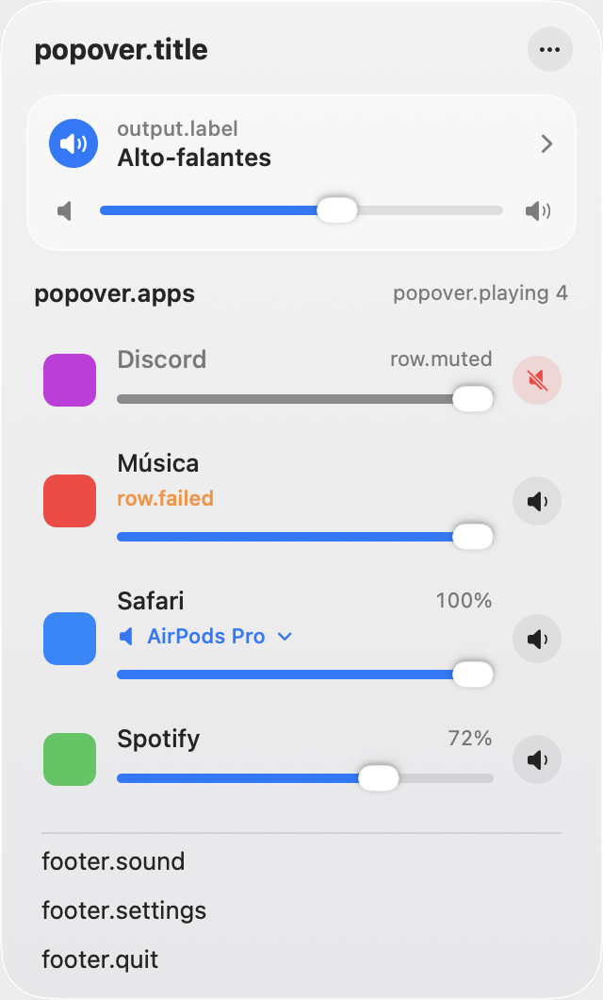
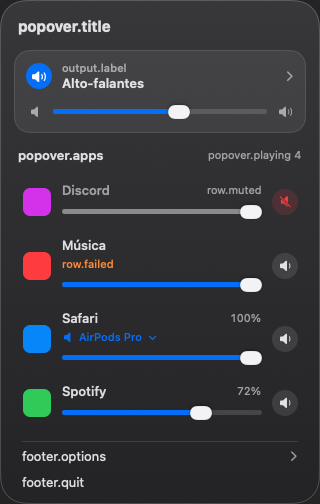

# Volume Manager

Mixer de volume **por app** para o macOS, na barra de menus. Baixe o volume do navegador sem mexer
no do Spotify, silencie só um app ou mande cada app para uma saída de áudio diferente. Feito em
Swift/SwiftUI, com os *process taps* do Core Audio, sem driver e sem extensão de kernel.

| Popover (claro) | Popover (escuro) |
|---|---|
|  |  |

Os prints acima são gerados pelos testes de snapshot. [print: janela de Ajustes real — a incluir]

## Requisitos
- macOS 15 ou mais novo em Mac com Apple Silicon (o build publicado é arm64).
- Permissão de **áudio do sistema**, pedida no primeiro uso. Nenhuma outra permissão.

## Instalação (a partir do DMG)
1. Baixe `Volume-Manager-<versão>.dmg` e o `SHA256SUMS` **somente** de
   <https://github.com/eduardo-toste/volume-manager/releases>. Não baixe de nenhum outro lugar.
2. [Confira o SHA-256](#conferir-o-sha-256).
3. Abra o DMG e arraste **Volume Manager** para **Aplicativos**.
4. Abra o app. Como o app não é assinado com conta da Apple, o macOS bloqueia a primeira abertura.
   Vá em **Ajustes do Sistema › Privacidade e Segurança**, role até a mensagem sobre o Volume
   Manager e clique em **Abrir Mesmo Assim** (só na primeira vez).
5. Conceda a permissão de áudio quando o app pedir.

**Alternativa pelo Terminal** (só se você baixou do endereço oficial e conferiu o SHA-256): isto
remove a marca de quarentena que faz o macOS bloquear a abertura, ou seja, desliga uma proteção
para este app.
```
xattr -dr com.apple.quarantine "/Applications/Volume Manager.app"
```

### Conferir o SHA-256
Com o DMG e o `SHA256SUMS` na mesma pasta:
```
shasum -a 256 -c SHA256SUMS --ignore-missing
```
Deve imprimir `OK` para o arquivo baixado. Compare também com o hash colado nas notas da Release.
Se não bater, apague o arquivo e não abra.

## Atualizar
Baixe o DMG novo (e confira o SHA-256) e substitua o app em Aplicativos. As permissões são
mantidas porque todos os releases são assinados com o mesmo certificado (`docs/SIGNING.md`). O app
não procura atualizações sozinho.

## Compilar
Precisa de Xcode (Swift 6) no macOS; sem dependências externas.
```
scripts/check.sh            # formatação, build sem avisos, testes e verificações de segurança
scripts/build-app.sh        # gera build/Volume Manager.app (assinatura ad hoc se VOLUME_SIGN_IDENTITY não estiver definida)
```
Uma build ad hoc serve só para desenvolvimento: o macOS esquece a permissão de áudio a cada
rebuild. Releases: `docs/RELEASE.md` e `docs/SIGNING.md`.

## Privacidade
- **Sem rede**: o app não faz nenhuma conexão (nem verifica atualização).
- **Nada é gravado**: o áudio só passa pela memória, multiplicado pelo volume; nada vai para
  arquivo, histórico ou análise.
- Sem telemetria. Só guarda, nas preferências do macOS, suas configurações e o volume/mudo/saída
  por app. "Esquecer todos" apaga isso.
- Pede **apenas** a permissão de áudio do sistema (nada de Acessibilidade, Microfone, Gravação de
  Tela etc.) e roda com Hardened Runtime sem exceções.

Detalhes e modelo de ameaças: `docs/SPEC.md` §12.9. Para reportar uma vulnerabilidade, veja
[SECURITY.md](SECURITY.md).
